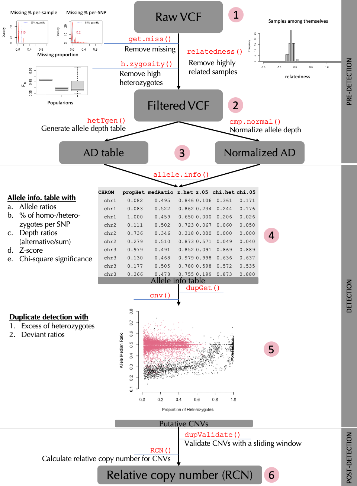
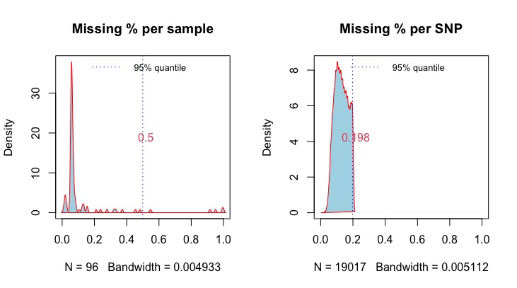
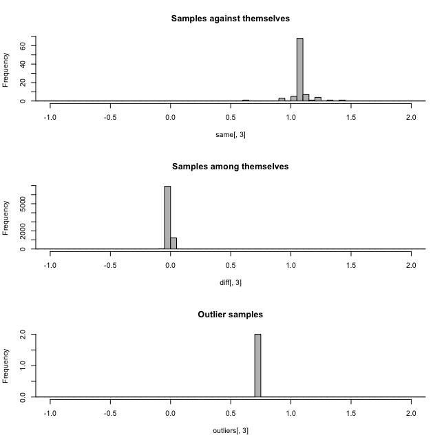
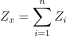
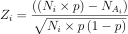
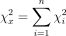
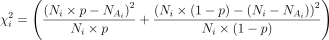
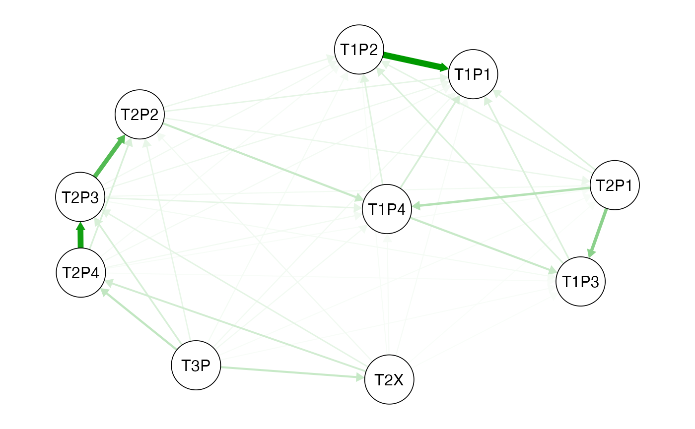

# Detecting CNV from SNPs: a quick guide to rCNV

## **rCNV: An R package for detecting copy number variants from SNPs data**

Piyal Karunarathne, Qiujie Zhou, and Pascal Milesi

This tutorial provides a complete guide to detecting CNVs from SNPs data
using rCNV package. This includes importing raw VCF files, filtering
them, normalization of read depth, categorization of SNPs into
“deviants” and “non-deviants”, and from which SNPs located in putative
CNV regions are filtered. A brief workflow is presented in Fig 1. below.



Fig. 1. Workflow of detecting CNVs with rCNV

All the data used in this tutorial is available either withing the
package or from the GitHub repository at
<https://github.com/piyalkarum/rCNV/tree/master/testDATA>.

We provide here a complete workflow of detecting CNVs from SNPs,
starting with raw (unfiltered) VCF as in the number 1 of the workflow
chart. However, if one believes that they have filtered VCFs for the
parameters we highlight (see Fig.1 and sub-sections 1.2 and 1.3), they
can start from the number 2 in the workflow shown above.  
*NOTE*: In the latest iteration of the rCNV package, the functions
[`sig.hets()`](../reference/sig.hets.md) and
[`dupGet()`](../reference/dupGet.md) use use a sample based inbreeding
coefficient *(Fis)* to improve the accuracy of the deviant detection.
This *Fis* is calculated using the
[`h.zygosity()`](../reference/h.zygosity.md) function; see below for
more information.

``` r
# Start by installing the package if you haven't already done so.  
# To install the CRAN version
install.packages("rCNV")

# Or if you would like to install the development version of the package
if (!requireNamespace("devtools", quietly = TRUE)) 
    install.packages("devtools") 
devtools::install_github("piyalkarum/rCNV", build_vignettes = TRUE)
```

### 1. PRE-DETECTION

#### 1.1 Importing data

    Raw VCF files can be imported to rCNV Renvironment using the
built-in function [`readVCF()`](../reference/readVCF.md). Theimported
vcf is stored as a data frame within a list.

``` r
library(rCNV)
vcf.file.path <- paste0(path.package("rCNV"), "/example.raw.vcf.gz")
vcf <- readVCF(vcf.file.path,verbose = FALSE)

# This imports an example VCF file included in the package
# The data is a partial dataset of Norway spruce data from Chen et al. 2019.
```

``` r
#print the first 10 rows and columns of the imported VCF
vcf$vcf[1:10,1:10]
```

    #>    #CHROM   POS     ID    REF    ALT      QUAL FILTER                 FORMAT
    #>    <char> <int> <char> <char> <char>     <num> <char>                 <char>
    #> 1:  MA_10 24959      .      A      C   4338.29   PASS GT:AD:DP:GQ:PGT:PID:PL
    #> 2:  MA_10 26811      .      C      T  33278.10   PASS         GT:AD:DP:GQ:PL
    #> 3:  MA_10 26860      .      A      G 273719.00   PASS GT:AD:DP:GQ:PGT:PID:PL
    #> 4:  MA_10 26874      .      T      C 374526.00   PASS GT:AD:DP:GQ:PGT:PID:PL
    #> 5:  MA_31 21911      .      C      G   2069.06   PASS         GT:AD:DP:GQ:PL
    #> 6:  MA_31 40129      .      A      T   6549.58   PASS         GT:AD:DP:GQ:PL
    #>                              AT_PA_06_12
    #>                                   <char>
    #> 1:             0/0:7,0:7:21:.:.:0,21,269
    #> 2:               0/0:18,0:18:22:0,22,576
    #> 3: 0/1:9,5:14:99:0|1:26860_A_G:183,0,775
    #> 4:             0/0:15,0:15:3:.:.:0,3,407
    #> 5:               0/0:11,0:11:33:0,33,319
    #> 6:               0/0:11,0:11:33:0,33,347

#### 1.2 Filtering VCF for missing data

      The raw VCF files often contain missingdata for both samples and
SNPs. If retained, these samples and SNPs canintroduce false positives
and negatives to the analysis. Therefore, theymust be removed based on a
missing percentage. The function[`get.miss()`](../reference/get.miss.md)
determines the missing percentages in samplesand SNPs and graphically
visualize the missing ranges with 5% quantilevalues. We recommend
removing samples and SNPs with missing percentageshigher than 50%.

The following example demonstrates such filtering on Parrot Fish data
from *Stockwell et al. (2016)*.

``` r
#download the parrotfish data (Stockwell et al. 2016) file from the following link to your working directory if you do not have the github folder
#https://github.com/piyalkarum/rCNV/blob/master/testDATA/Parrotfish_sequenceReads.vcf.gz
#and specify the path fl= to your file.
fl<-"../testDATA/Parrotfish_sequenceReads.vcf.gz"
parrot<-readVCF(fl,verbose=F)
mss<-get.miss(parrot,verbose = F, plot=F)
```

This generates a list with missing percentage tables for SNPs and
samples and a plot similar to Fig 1.2 where missing percentages are
plotted. Users can also manually plot these percentages on their
discretion. Further, if desired one type of missing percentage (i.e. per
sample or per SNP) can be calculated separately by specifying the
argument `type=` in the [`get.miss()`](../reference/get.miss.md)
function. See the help page of [`get.miss()`](../reference/get.miss.md)
for more information.



Fig.1.2. Missing status of the VCF

``` r
head(mss$perSample)
#>   indiv n_miss     f_miss
#> 1  DP_1   1089 0.05726455
#> 2 DP_10   1086 0.05710680
#> 3 DP_11   1365 0.07177788
#> 4 DP_12   1091 0.05736972
#> 5 DP_13   1069 0.05621286
#> 6 DP_14    387 0.02035021
```

The plot shows that there are several samples with missing data for more
than 50% of the SNPs. It is recommended to remove these before
proceeding with further analysis. Removing them from the imported vcf
file is just a matter of obtaining the columns (samples) for which
missing percentage if \>50%.

``` r
dim(parrot$vcf)
#> [1] 19017   105
sam<-which(mss$perSample$f_miss>0.5)+9 #here we determine the sample columns with f_miss>0.5 and add 9 to get the correct column number because there are 9 more columns before the sample columns start.
parrot<-data.frame(parrot$vcf)[,-sam]
dim(parrot)
#> [1] 19017   100
```

We have removed 5 samples that were undesired for the analysis due to
their missing data. Undesired SNPs can also be removed the same way;
Note: now they are in rows.

#### 1.3 Assessing the relatedness among samples and heterozygosity within

The function [`relatedness()`](../reference/relatedness.md) in the rCNV
package will generate the relatedness index between pairs of samples
according to *Yang et al. (2010)*. The output is a data frame with pairs
of samples and the relatedness score *Ajk*. Please read *Yang et
al. (2010)* for more information on the calculation of *Ajk*.

``` r
rels<-relatedness(parrot)
head(rels)
```

From the relatedness plots, we can see that the relatedness in Parrot
fish samples is low. We recommend removing one sample of the pairs with
outlier values above 0.9.



Figure 1.3. a. Relatedness among samples, b. Heterozygosity in
Parrotfish populations

Heterozygosity within populations can be calculated using
[`h.zygosity()`](../reference/h.zygosity.md) function.

  \* NOTE: A list of populations corresponding tothe samples must be
provided in order to plot the heterozygosity amongpopulations.

``` r
pops<-substr(colnames(parrot)[-c(1:9)],1,2) #population codes (the first two letters of the sample names)
hz<-h.zygosity(parrot,pops=pops)
head(hz)
```

In figure 1.3.b, we can see that most of the individuals has a mean
heterozygosity F_(IS) close to 0.19, except for a few outliers. However,
outliers with an F_(IS) value below -0.2 is highly likely DNA
contamination. Therefore, it is recommended to remove such samples.

### 1.4 Generating allele depth tables and normalized depth values

Allele read depth table is the main data that will be used for the rest
of the analysis. Therefore, having them generated and stored for later
use will immensely save a lot of time. The function
[`hetTgen()`](../reference/hetTgen.md) is especially dedicated for this
purpose. Apart from generating filtered allele depth table for separate
alleles (`info.type="AD"`), the function can also generate total allele
depth (`info.type="AD-tot"`), genotype table (`info.type="GT"`), etc..
See the help page of [`hetTgen()`](../reference/hetTgen.md) for more
formats.

``` r
ad.tab<-hetTgen(parrot,info.type="AD")
ad.tab[1:10,1:6]
```

Table 1.4.0 Allele depth table (generated from a larger data set of
Stockwell et al. 2016 Parrot fish data)

|       | CHROM |    POS |     ID | ALT | KKOGR07_0005_combo | KKOGR07_0006 |
|:------|:------|-------:|-------:|:----|:-------------------|:-------------|
| 7452  | un    | 705339 |  67808 | A   | 45,0               | 34,0         |
| 18079 | un    | 769896 |  80692 | T   | 16,0               | 15,0         |
| 9793  | un    | 926883 | 109573 | A   | 56,0               | 42,0         |
| 11755 | un    | 172395 |  16363 | C   | 61,67              | 40,34        |
| 10122 | un    |  18102 |   1703 | A   | 75,0               | 51,0         |
| 816   | un    |  76725 |   6991 | C   | 66,41              | 20,20        |

As an additional step, rCNV framework corrects allele depth values for
genotype misclassifications (where genotype and the depth values do not
match) and odd number anomalies (where total depth of a loci is odd).

``` r
#the genotype table is needed for correcting the genotype mismatches
gt<-hetTgen(parrot,info.type = "GT")
ad.tab<-ad.correct(ad.tab,gt.table = gt)
```

It is recommended to normalize the allele depth values across samples in
order to avoid the depth variation arise from sequencing heterogeneity
where some samples tend to have higher depth values compared to others
due to different origin of sequencing efforts. We provide several
methods for normalizing data.  
\| TMM = trimmed mean of M values \| MedR = median ratio normalization
\| QN = quantile based normalization \| pca = PCA based normalization

\*Please read the function help for more information on the different
methods

``` r
#normalize depth table with cpm.normal()
ad.nor<-cpm.normal(ad.tab,method="MedR")
ad.nor[1:6,1:6]
```

Table 1.4.1 Normalized allele depth table

    #> OUTLIERS DETECTED
    #> Consider removing the samples:
    #> KKOGR07_0030 KKOGR07_0043_combo KKOKT10_0069

|       | CHROM |    POS |     ID | ALT | KKOGR07_0005_combo | KKOGR07_0006 |
|:------|:------|-------:|-------:|:----|:-------------------|:-------------|
| 7452  | un    | 705339 |  67808 | A   | 29,0               | 34,0         |
| 18079 | un    | 769896 |  80692 | T   | 10,0               | 15,0         |
| 9793  | un    | 926883 | 109573 | A   | 36,0               | 42,0         |
| 11755 | un    | 172395 |  16363 | C   | 39,43              | 40,34        |
| 10122 | un    |  18102 |   1703 | A   | 48,0               | 51,0         |
| 816   | un    |  76725 |   6991 | C   | 42,26              | 20,20        |

Compare the allele depth values between tables 1.4.0 and 1.4.1.

### 2. DETECTION

#### 2.1 Generating allele information table

In this step, all the statistics necessary for detecting duplicates are
calculated. They include the following: a. Allele ratios (across all
samples), b. Proportions of homo-/hetero-zygotes per SNP, c. Depth
ratios (alternative/sum), d. Z-score, e. Chi-square significance, and
f. excess of heterozygosity.

\[see section 2.4 for alternative detection statistics for whole genome
sequencing (WGS) data\]

Alternative allele ratio is calculated across all the samples from depth
values; Proportion of homo/hetero-zygotes are also calculated across all
the samples per SNP; Depth ratio is calculated per individual per SNP by
dividing the alternative allele depth value by the total depth value of
both alleles. This is calculated for both heterozygotes and homozygotes;
the Z-score per SNP is calculated according to the following equation:



z-sqr



z-squre2

Where *N_(i)* is the total depth for heterozygote *i* at SNP *x*,
*N_(Ai)* is the alternative allele read depth for heterozygote *i* at
SNP *x*, *p* is the probability of sampling allele *A* in SNP *x* - for
unbiased sequencing, this is *0.5*. The
[`allele.info()`](../reference/allele.info.md) function calculates this
for both *0.5* and biased probability using the ratio between reference
and alternative alleles.

The Chi-squared values per SNP per sample were calculated using the
following equation:



chi-sqr



chi-sqr2

Where *N_(i)* is the total depth for heterozygote *i* at SNP *x*,
*N_(Ai)* is the alternative allele read-depth for heterozygote *i* at
SNP *x*, *p* is the probability of sampling allele *A* at SNP *x* in
heterozygotes - in unbiased sequencing, this is *0.5*, *n* is the number
of heterozygotes at SNP *x*.

In addition to the above a-e parameters several other important
statistics per sample per SNP is generated in the
[`allele.info()`](../reference/allele.info.md) output.

``` r
# in the new version of the package allele.info() and dupGet() functions require Fis value for a more accurate detection of the deviants
# this is obtained by using the h.zygosity() function as below
hz<-h.zygosity(parrot,verbose = FALSE) #parrot is the filtered vcf file
Fis<-mean(hz$Fis,na.rm = TRUE)
A.info<-allele.info(X=ADtable,x.norm = ADnorm, plot.allele.cov = TRUE,Fis=Fis)
# X is the corrected non-normalized allele depth table and x.norm is the normalized allele depth table
head(A.info)
```

    #>       CHROM    POS     ID NHet    propHet  medRatio NHomRef NHomAlt propHomAlt
    #> 7452     un 705339  67808    9 0.08653846 0.5000000      95       0 0.00000000
    #> 18079    un 769896  80692   41 0.40594059 0.5000000      48      12 0.11881188
    #> 9793     un 926883 109573   54 0.51923077 0.5096539      34      16 0.15384615
    #> 10122    un  18102   1703    8 0.07619048 0.5174242      97       0 0.00000000
    #> 816      un  76725   6991   49 0.47115385 0.4897959      35      20 0.19230769
    #> 17482    un 713297  72437   46 0.43809524 0.5217593      52       7 0.06666667
    #>       Nsamp      pAll      pHet       fis     z.het      z.05     z.all
    #> 7452    104 0.5514787 0.5154153 0.9899497 0.9816955 0.5373322 0.1694981
    #> 18079   101 0.5079704 0.4822855 0.9907917 0.9630120 0.3160515 0.1518454
    #> 9793    104 0.5043221 0.4939181 0.9897064 0.6531659 0.8933630 0.5832463
    #> 10122   105 0.4610830 0.4917005 0.9900990 0.7954672 0.5758174 0.3945965
    #> 816     104 0.5007013 0.5003297 0.9907469 0.6343455 0.6562743 0.6100144
    #> 17482   105 0.5085058 0.5166027 0.9897778 0.9822687 0.1245431 0.4469195
    #>         chi.het    chi.05   chi.all   z.het.sum    z.05.sum z.all.sum
    #> 7452  0.9175753 0.9061279 0.8927433 -0.06882976  -1.8505568  4.121455
    #> 18079 0.9999231 0.9999047 0.9998801  0.29693961   6.4198038  9.175957
    #> 9793  0.9999640 0.9999651 0.9999629 -3.30217028   0.9850626  4.031731
    #> 10122 0.7615202 0.7593583 0.7221300  0.73317868   1.5825180 -2.407872
    #> 816   0.9995718 0.9995749 0.9995681  3.32933637   3.1154399  3.570371
    #> 17482 0.9996000 0.9992832 0.9995143 -0.15073519 -10.4175272 -5.158373
    #>       chi.het.sum chi.05.sum chi.all.sum   eH.pval   eH.delta        cv
    #> 7452     3.251816   3.409112    3.581875 0.6446423  0.3894231 1.0112356
    #> 18079   14.588811  14.828298   15.091843 0.4819957 -3.0841584 0.9649802
    #> 9793    21.505630  21.466620   21.545469 0.4719765  3.5576923 0.7752089
    #> 10122    4.157058   4.175480    4.488264 0.6848750  0.3047619 1.0355910
    #> 816     21.872400  21.860947   21.885888 0.7008333 -1.9182692 0.7840350
    #> 17482   19.798998  20.702798   20.092246 0.4523861  3.1428571 0.8057838

#### 2.2 Deviants detection

In this step, the allele information table generated in the previous
step is used to detect deviant SNPs based on different models
(statistics), which then is used in the next step with the appropriate
test statistic to filter putative CNVs. The rCNV function
[`dupGet()`](../reference/dupGet.md) delivers easy to pick model
selection to detect deviant SNPs with a plotting option to visualize the
detection.

``` r
# Run this code for a demonstration of the detection
# Fis is calculated as before using h.zygosity()
dvs<-dupGet(alleleINF,test = c("z.05","chi.05"),Fis=0.11)
# z score and chi-square values given p=0.05 is used here because the data is RADseq generated and probe-biase is neglegible

head(dvs)
```

The detection of deviant SNPs is based on the **heterozygosity** within
populations (or among all samples) and **allelic ratios** within such
heterozygotes. As such, [`dupGet()`](../reference/dupGet.md) function
implements three methods to flag the deviant alleles; They are a) Excess
of heterozygotes, b) Heterozygous SNPs with depth values that do not
follow normal Z-score distribution, and c) Heterozygous SNPs with depth
values that do not follow normal chi-square distribution.

  The proportion of heterozygotes in apopulation according to HWE is 2pq
where as homozygotes isq². In deviant SNPs heterozygosity is expected to
be higherindicating excess of heterozygosity and thus flagged
asdeviant/putative-CNVs.

  In non-duplicated alleles (non-CNVs), medianallele ratio must be ~0.5,
however, in deviants, it varies between 1:3and 3:1. These SNP deviants
are also flagged as putative CNVs. Todetermine the deviation, we use the
Z-score values and Chi-squaresignificance calculated in the previous
step.

  \*\*NOTE: users can select the expected allelefrequency (p: ) of the
alternative allele based on the sequencing methodand the probe bias
therein. See our publication <https://doi.org/10.1101/2022.10.14.512217>
for moredetails on probe bias.

``` r
deviants<-dupGet(alleleINF,Fis=Fis,test = c("z.all","chi.all"),plot=TRUE,verbose = TRUE)
head(deviants)
```

    #>       CHROM    POS     ID NHet    propHet  medRatio NHomRef NHomAlt propHomAlt
    #> 7452     un 705339  67808    9 0.08653846 0.5000000      95       0 0.00000000
    #> 18079    un 769896  80692   41 0.40594059 0.5000000      48      12 0.11881188
    #> 9793     un 926883 109573   54 0.51923077 0.5096539      34      16 0.15384615
    #> 10122    un  18102   1703    8 0.07619048 0.5174242      97       0 0.00000000
    #> 816      un  76725   6991   49 0.47115385 0.4897959      35      20 0.19230769
    #> 17482    un 713297  72437   46 0.43809524 0.5217593      52       7 0.06666667
    #>       Nsamp   eH.pval   eH.delta    dup.stat
    #> 7452    104 0.6446423  0.3894231 non-deviant
    #> 18079   101 0.4819957 -3.0841584 non-deviant
    #> 9793    104 0.4719765  3.5576923 non-deviant
    #> 10122   105 0.6848750  0.3047619 non-deviant
    #> 816     104 0.7008333 -1.9182692 non-deviant
    #> 17482   105 0.4523861  3.1428571 non-deviant

The function also plots the deviants with Allele median ratio Vs
Proportion of Heterozygotes to visualize and validate the detection by
the user. Users can also plot the detection separately with the output
of [`dupGet()`](../reference/dupGet.md) using
[`dup.plot()`](../reference/dup.plot.md) function.


Fig 2.1 Median allele ratio Vs Prop. of Heterozygotes with deviant
alleles

#### 2.3 Filtering putative CNVs

SNPs that are located in putative CNV regions are filtered using two
methods; 1) intersection: using a combination of at least two statistics
used in deviant detection. i.e., excess of heterozygotes, Z-score
distribution and Chi-square distribution, 2) K-means: using an
unsupervised clustering based on Z-score, chi-square, excess of
heterozygotes, and coefficient of variation from read-depth dispersion.
The significant SNPs from either of the `filtering` are flagged as
putative duplicates. The users can pick a range of optimal statistics
(e.g. `z.all`,`chi.all`,`z.05`,`chi.05`, etc.) depending on the nature
(also sequencing technology) of the underlying data. The function
[`cnv()`](../reference/cnv.md) is dedicated for this purpose.

``` r
CV<-cnv(alleleINF, test=c("z.05","chi.05"), filter = "kmeans")
# see the difference between deviants and duplicates
table(deviants$dup.stat)
table(CV$dup.stat)
```


Fig 2.1 Median allele ratio Vs Prop. of Heterozygotes with putative
duplicates

    #> 
    #>     deviant non-deviant 
    #>         335        2522
    #> 
    #>     cnv non-cnv 
    #>     388    2469

#### 2.4 Detection of multicopy regions from WGS data

**rCNV is currently developing methods to detect multicopy regions
specifically dedicated to whole genome sequencing data using maximum
likelihood ratios.** The following script is a sneak-peak of how this
method can be used using SNP data sets of WGS data. *Stay tuned for more
updates and a full description of the complete WGS CNV detection
process.*

rCNV detects multicopy regions in whole-genome sequencing data using
maximum-likelihood ratios on joint genotype + depth signals. Two
variants are provided:

- allele.info.WGS3() — fast, no reference required.
- allele.info.WGS.GCcor() — corrects for GC-driven depth bias using
  SNP-centred windows.

Both functions accept either a VCF path or an already-loaded VCF using
[`readVCF()`](../reference/readVCF.md) function, return a single merged
data.frame with per-SNP duplication status (and optionally deletion
status with deletion = TRUE), and support restricting analysis to a
subset of chromosomes (chroms = c(“chr1”,“chr2”)) or to regions in a BED
file (bed = “regions.bed”).

1.  **Without GC correction**

``` r
out <- allele.info.WGS3(vcf = "path/to/wgs/data.vcf")
```

2.  i **With GC correction (requires reference FASTA)**

``` r
out <- allele.info.WGS.GCcor(
  vcf = "path/to/wgs/data.vcf",
  ref = "path/to/genome.fa"
)
```

2.  ii **Restrict to specific chromosomes or BED regions, also test
    deletions**

``` r
out <- allele.info.WGS.GCcor(
  vcf      = "path/to/wgs/data.vcf",
  ref      = "path/to/genome.fa",
  chroms   = c("chr1", "chr2"),     # OR: bed = "regions.bed"
  deletion = TRUE,
  parallel = TRUE, numCores = 8
)
```

Output is a data.frame with one row per SNP, carrying duplication (and
optionally deletion) status alongside likelihood ratios, permutation
thresholds, depth, and allele-frequency stats. See
`allele.info.WGS.GCcor` and `allele.info.WGS3` for full column
descriptions.

**Use the following script if the above two fail with your data**

``` r
vcf<-readVCF("path/to/wgs/data.vcf")
fis<-mean(h.zygosity(vcf)$Fis)
gt<-hetTgen(vcf,"GT")
ad<-hetTgen(vcf,"AD")
ad[ad==""] <- "0,0"

out<-allele.info.WGS(ad,gt,fis)
# out is a data frame with duplication status of each snp, and other stats, can be used directly with cnv()
cv<-cnv(out,fis=fis)
```

### 3. POST-DETECTION

#### 3.1 Duplicate list and validation

We test the validity of detected duplicates in two ways: 1. direct
detection through a sliding window and 2. variant fixation index

- The sliding window method assess the duplication along
  chromosomes/scaffolds on a given size (e.g., 10,000 bp) sliding
  window. This step assumes that ideally, if a locus is truly located in
  a multi-copy region, close-by SNPs should also be classified as
  deviants while deviation caused by sequencing error should be more
  scattered along the genome. The putative duplicates that do not follow
  this assumption will be flagged as low-confident and can be removed if
  desired. The function `dup.validate` in the rCNV package is dedicated
  to detecting regions enriched for deviant SNPs within a sliding window
  along a chromosome, scaffold, or a sequence of any given length.  
  **Check the function example in the package for how to use it. Note
  that this method is still being tested**

- Variant fixation index ($`V_{ST}`$ : Redon et al. 2006) is analogous
  to population fixation index ($`F_{ST}`$) and calculated as
  $`V_{ST} = V_S/V_T`$ where $`V_T`$ is the variance of normalized read
  depths among all individuals from the two populations and VS is the
  average of the variance within each population, weighed for population
  size; and used to identify distinct CNV groups between populations
  (See Dennis et al., 2017; Weir & Cockerham, 1984) The function `vst`
  can be used to calculate the $`V_{ST}`$ values per population and plot
  genetic distance in a network qgraph.

``` r
# the dataset used here is from Dorrant et al. 2020 of American lobster populations in Gulf of St. Lawrence, Canada
vdata<-readRDS("../testDATA/lobster_data4Vst.rds")
# get the total depth values of the duplicated snps
# You can either use the following line to get the total depth of the samples or use the "tot" option of the hetTgen function to generate the total depth table
dd<-rCNV:::apply_pb(vdata[,-c(1:4)],2,function(x){do.call(cbind,lapply(x,function(y){sum(as.numeric(unlist(strsplit(as.character(y),","))))}))})
pops<-substr(colnames(dd),1,4)
dd<-data.frame(vdata[,1:4],dd)
Vs<-vst(dd,pops=pops)
```

 Fig. 3.1. Vst network
qgraph generated from the Vst values for each lobster population.
Circles represent populations and the green arrows show similarity and
the direction.See `qgraph` help for the interpretation of the network
analysis.

NOTE: You can also run a permutation test (using `vstPermutation`) on
the vst calculation to test the randomness of the vst.

#### 3.2 Relative copy number

TBA

### 4. References

- Chen, J., Li, L., Milesi, P., Jansson, G., Berlin, M., Karlsson, B., …
  Lascoux, M. (2019). Genomic data provide new insights on the
  demographic history and the extent of recent material transfers in
  Norway spruce. Evolutionary Applications, 12(8), 1539–1551. doi:
  10.1111/eva.12801

- Dorant, Y., Cayuela, H., Wellband, K., Laporte, M., Rougemont, Q.,
  Mérot, C., … Bernatchez, L. (2020). Copy number variants outperform
  SNPs to reveal genotype–temperature association in a marine species.
  Molecular Ecology, 29(24), 4765–4782. doi: 10.1111/mec.15565

- Karunarathne P, Zhou Q, Schliep K, Milesi P. A comprehensive framework
  for detecting copy number variants from single nucleotide polymorphism
  data: ‘rCNV’, a versatile r package for paralogue and CNV detection.
  Mol Ecol Resour. 2023 Jul 29. doi: 10.1111/1755-0998.13843

- Karunarathne, P., Zhou, Q., Schliep, K., & Milesi, P. (2022). A new
  framework for detecting copy number variants from single nucleotide
  polymorphism data: ‘rCNV’, a versatile R package for paralogs and CNVs
  detection. BioRxiv, 2022.10.14.512217. doi: 10.1101/2022.10.14.512217

- Redon, R., Ishikawa, S., Fitch, K. R., Feuk, L., Perry, G. H.,
  Andrews, T. D., … Chen, W. (2006). Global variation in copy number in
  the human genome. Nature, 444(7118), 444–454.

- Stockwell, B. L., Larson, W. A., Waples, R. K., Abesamis, R. A.,
  Seeb, L. W., & Carpenter, K. E. (2016). The application of genomics to
  inform conservation of a functionally important reef fish (Scarus
  niger) in the Philippines. Conservation Genetics, 17(1), 239–249

- Yang, J., Benyamin, B., McEvoy, B. P., Gordon, S., Henders, A. K.,
  Nyholt, D. R., … Visscher, P. M. (2010). Common SNPs explain a large
  proportion of the heritability for human height. Nature Genetics,
  42(7), 565–569. doi: 10.1038/ng.608
