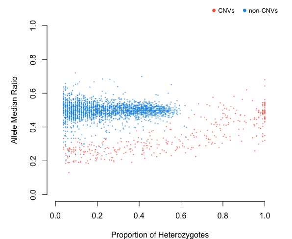

# rCNV

# rCNV: An R package for detecting copy number variants from SNPs data

Piyal Karunarathne, Qiujie Zhou, Klaus Schliep, and Pascal Milesi

**rCNV** was designed to identify duplicates (CNV) from SNPs data with
ease.



***For a comprehensive tutorial on the package, go to
<https://piyalkarum.github.io/rCNV/> and navigate to “Get started” where
all the functions and usage are explained with ample examples.***

## NEWS

rCNV is currently developing methods to detect multicopy regions from
whole genome sequencing (WGS) data using maximum likelihood ratios.
**For a sneak peek, go to the section 2.4 at
<https://piyalkarum.github.io/rCNV/>**

## Installation

- CRAN link <https://cran.r-project.org/package=rCNV>

``` R
install.packages("rCNV")
```

- \[RECOMMENDED\] You can install the development version of rCNV from
  [GitHub](https://github.com/) with:

``` R
    if (!requireNamespace("devtools", quietly = TRUE)) 
        install.packages("devtools") 
    devtools::install_github("piyalkarum/rCNV", build_vignettes = TRUE)
```

> **Note:** The WGS functions (`allele.info.WGS3` and
> `allele.info.WGS.GCcor`) depend on several Bioconductor packages that
> are not available on CRAN. If you encounter installation errors,
> install these first:
>
> ``` R
> if (!requireNamespace("BiocManager", quietly = TRUE))
>     install.packages("BiocManager")
> BiocManager::install(c("Rsamtools", "Biostrings", "GenomicRanges",
>                        "GenomeInfoDb", "BiocGenerics", "IRanges",
>                        "S4Vectors", "rtracklayer"))
> ```
>
> Then re-run the `install_github` command above.

Please don’t forget to cite us if you use the package.

## How to cite

- Karunarathne P, Zhou Q, Schliep K, Milesi P. A comprehensive framework
  for detecting copy number variants from single nucleotide polymorphism
  data: ‘rCNV’, a versatile r package for paralogue and CNV detection.
  Mol Ecol Resour. 2023 Jul 29.
  doi:<http://doi.org/10.1111/1755-0998.13843>

- Karunarathne, P., Zhou, Q., Schliep, K., & Milesi, P. (2022). A new
  framework for detecting copy number variants from single nucleotide
  polymorphism data: ‘rCNV’, a versatile R package for paralogs and CNVs
  detection. BioRxiv, 2022.10.14.512217.
  doi:<http://doi.org/10.1101/2022.10.14.512217>
